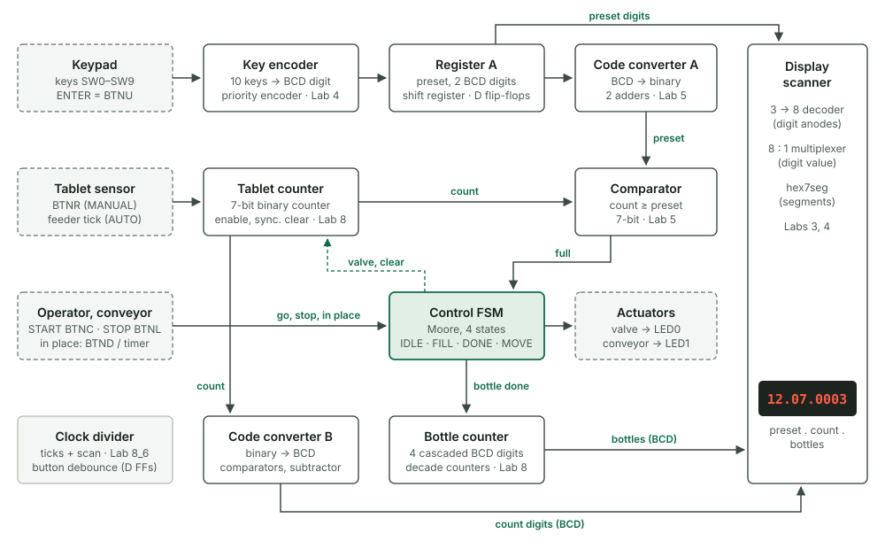
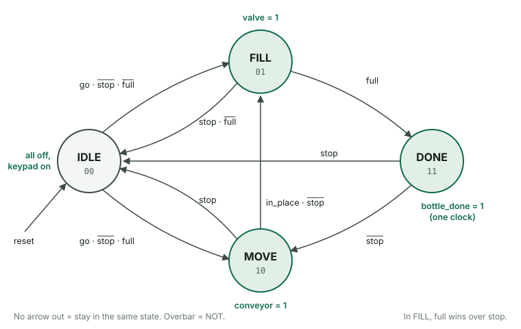
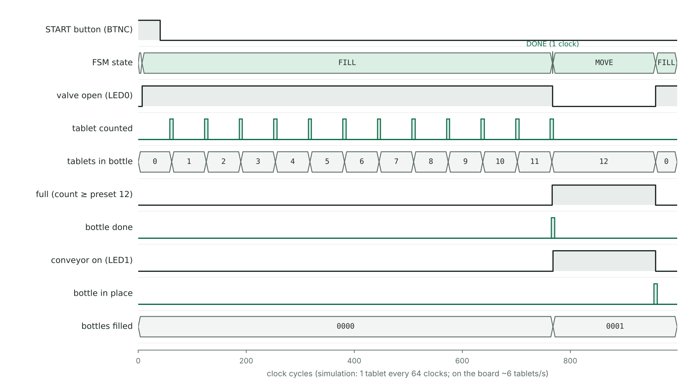

# Tablet-Bottling Controller on an FPGA

**Digital Design course project** · University of Debrecen, Faculty of Informatics · Verilog · Xilinx ISE 14.7 · Digilent Nexys 4 DDR (Artix-7 XC7A100T)

The tablet-bottling system from the Digital Design lecture (after Floyd, *Digital Fundamentals*) is built here as one working digital system. The operator types the number of tablets per bottle on a keypad. The controller then opens a valve, counts tablets from a sensor, closes the valve when the bottle is full, runs the conveyor to bring the next bottle, and counts the bottles filled.

It is built only from the course's building blocks: encoder, registers, code converters, comparator, counters, a finite state machine and a 7-segment display driver. There are no IP cores and no processor.

- [x] Verified in simulation: 3 self-checking testbenches, all pass
- [ ] Tested on the Nexys 4 DDR board



## Running it on the board

| Board part | Use |
| --- | --- |
| SW0–SW9 | keypad keys 0–9 |
| BTNU | ENTER: add the key that is switched on to the preset |
| BTNC | START |
| BTNL | STOP (hold) |
| SW15 | 1 = AUTO (built-in tablet feeder and conveyor timer), 0 = MANUAL |
| BTNR | tablet sensor (MANUAL) |
| BTND | next bottle in place (MANUAL) |
| CPU RESET | reset everything |
| Display | `PP.CC.BBBB`: tablets per bottle, tablets in this bottle, bottles filled, e.g. `12.07.0003` |
| LED0, LED1 | valve open, conveyor running |
| LED2, LED3, LED4 | bottle full, idle, keypad enabled |
| LED5, LED6, LED7 | key switch on, AUTO mode, heartbeat |
| LED8–LED14 | tablet count in binary (compare it with the decimal display) |
| LED15 | STOP held |

Demo:

1. Press CPU RESET.
2. Switch SW1 on, press BTNU, switch it off. Then SW2, BTNU, off. The display shows `12.00.0000`.
3. Switch SW15 on (AUTO) and press BTNC. The valve LED lights and the count rises by about 6 tablets per second. At 12 the valve closes and the conveyor LED runs for about 2 seconds. The bottle count goes up and the next bottle starts filling.
4. Hold BTNL at any time: valve and conveyor stop. BTNC continues from where it stopped.
5. Switch SW15 off (MANUAL): BTNR adds one tablet, BTND brings the next bottle.

The preset can only be changed while the machine is stopped and the bottle is empty. A START with preset `00` is ignored.

## Design

A full walkthrough of every module, the design decisions, the FSM derivation and the verification plan is in [docs/PROJECT_GUIDE.md](docs/PROJECT_GUIDE.md).

### Modules and the course topics behind them

| Module | What it does | Course topic |
| --- | --- | --- |
| `key_encoder.v` | 10 keys → BCD digit, highest key wins | Lab 4 priority encoder |
| `preset_reg.v` | Register A: two BCD digits, shifted in like a calculator | registers, shift registers |
| `bcd2bin.v` | code converter A: BCD → binary, tens × 10 = tens × 8 + tens × 2 | BCD code, Lab 5 adders |
| `counter.v` | 7-bit tablet counter, conveyor timer | Lab 8 counters, synchronous clear |
| `comparator.v` | tablets in bottle vs. preset | Lab 5 comparator |
| `bottling_fsm.v` | Moore FSM, written as a `case` statement | finite state machines |
| `bottling_fsm_gates.v` | the same FSM from hand-derived equations | FSM design steps 4–7 |
| `bcd_counter.v` | decade counter; 4 cascaded for the bottle count | Lab 8 decimal counter, cascaded counters |
| `bin2bcd.v` | code converter B: binary → two BCD digits | comparators, subtraction |
| `display_mux.v` | scans the 8 digits | Lab 4 decoder and multiplexer |
| `hex7seg.v` | 7-segment patterns | Lab 3 (unchanged) |
| `clkdiv.v` | 27-bit divider → digit select and enable ticks | Lab 8 clock divider |
| `btn_pulse.v` | button synchronizer, debouncer, edge detector | D flip-flops (Lab 7) |
| `bottling_top.v` | connects everything to the board pins | top module (Lab 8) |

### Control FSM



The FSM was designed with the lecture's FSM design steps.

**1. Inputs and outputs.**

- Inputs:
    - `go`: START pressed and the preset is not 0
    - `stop`: STOP held
    - `full`: tablets ≥ preset, from the comparator
    - `in_place`: next bottle under the valve
- Outputs: `valve`, `conveyor`, `bottle_done` (one clock), `idle`.

**2–3. State diagram and transition table.**

| Current state | Inputs | Next state |
| --- | --- | --- |
| IDLE | `stop` | IDLE |
| IDLE | `~stop & go & ~full` | FILL |
| IDLE | `~stop & go & full` | MOVE |
| FILL | `full` | DONE |
| FILL | `~full & stop` | IDLE |
| DONE | `stop` | IDLE |
| DONE | `~stop` | MOVE |
| MOVE | `stop` | IDLE |
| MOVE | `~stop & in_place` | FILL |
| any | none of the above | same state |

| State | Code S1 S0 | `valve` | `conveyor` | `bottle_done` | `idle` |
| --- | --- | --- | --- | --- | --- |
| IDLE | 00 | 0 | 0 | 0 | 1 |
| FILL | 01 | 1 | 0 | 0 | 0 |
| DONE | 11 | 0 | 0 | 1 | 0 |
| MOVE | 10 | 0 | 1 | 0 | 0 |

**4–6. Binary encoding and Boolean equations** (`~` = NOT, `&` = AND, `|` = OR):

```
S1' = S1 & ~stop & (S0 | ~in_place)  |  ~S1 & full & (S0 | ~stop & go)
S0' = ~S1 & ~S0 & ~stop & go & ~full  |  ~S1 & S0 & (full | ~stop)  |  S1 & ~S0 & ~stop & in_place

valve = ~S1 & S0    conveyor = S1 & ~S0    bottle_done = S1 & S0    idle = ~S1 & ~S0
```

**7. Circuit.** `bottling_fsm_gates.v` builds these equations from gates and two flip-flops. A testbench proves it behaves exactly like the `case` version.

Two rules keep the bottle count correct when STOP is used:

- In FILL, `full` has priority over `stop`, so a bottle that reaches its count is always counted.
- START from IDLE goes to MOVE when the bottle is already full, so a bottle is never counted twice.

### One clock for the whole design

In the labs, divided clocks such as `q[26]` drive other flip-flops. Here every flip-flop runs on the 100 MHz clock, and the divider makes one-clock enable "ticks" instead (D flip-flop with enable), so the design is fully synchronous.

Buttons and switches pass through two-flip-flop synchronizers. Buttons are also debounced by sampling them every 10.5 ms. The display shows each digit for 1.3 ms, so all 8 digits refresh at about 95 Hz with no flicker.

## Verification

| Testbench | What it checks | Result |
| --- | --- | --- |
| `tb_blocks.v` | Every input combination of `hex7seg` (16), `key_encoder` (1,024), `bcd2bin` (100), `bin2bcd` (128) and `comparator` (16,384). Also the 4-digit BCD counter through 10,000 counts and back to `0000`. | 27,652 checks, 0 errors |
| `tb_fsm_equiv.v` | Behavioral FSM against the gate-level FSM over 200,000 clocks of random inputs and resets | 0 mismatches; all 64 state/input combinations covered |
| `tb_bottling_top.v` | Whole system: reset, keypad entry, START blocked at preset 00, 5 bottles in AUTO, STOP and resume while filling and while moving, keypad locked while running, MANUAL mode with bouncing buttons, display digits and decimal points | 26 scenario checks, 0 errors |

The system testbench also checks three safety rules on every clock (6,327 clocks):

- valve and conveyor are never on together
- a bottle is never overfilled
- no tablet is counted while the valve is closed

The expected values are computed differently from the design (loops, `/` and `%`), so a mistake cannot hide in its own test. Open-source synthesis (Yosys) finds no latches.



*One bottle in AUTO mode, from the system simulation (preset 12). One-clock pulses are drawn wider so they are visible. In simulation a tablet comes every 64 clocks; on the board it comes every 168 ms.*

## Build and run

**Xilinx ISE 14.7 (as in the lab)**

1. New Project, top-level source type HDL.
2. Device: Family Artix7, Device XC7A100T, Package CSG324, Speed -1 (the lab slides use -3, which also works here). Synthesis XST, Simulator ISim, Preferred Language Verilog.
3. *Project → Add Copy of Source*: every file in `src/` and `constraints/nexys4ddr.ucf`. Set `bottling_top` as the top module.
4. Optional: XST may re-encode the FSM. To keep the codes 00/01/11/10, set *Synthesize → Process Properties → FSM Encoding Algorithm* to **User**.
5. *Generate Programming File*, then program `bottling_top.bit` with iMPACT or Digilent Adept.

To simulate in ISim:

1. Add a file from `sim/` in Simulation view.
2. Run *Simulate Behavioral Model*.
3. Type `run all` in the console; the testbench prints `PASS` or `FAIL`.

**Vivado** (if ISE 14.7 does not install on Windows 10/11): create a project for part `xc7a100tcsg324-1`. Add `src/` and `constraints/nexys4ddr.xdc`, then run Generate Bitstream.

**Icarus Verilog** (free, any OS): `cd sim && ./run_sim.sh` runs all three testbenches.

## Repository layout

```
src/           Verilog design, 14 modules
sim/           testbenches and run_sim.sh
constraints/   nexys4ddr.ucf (ISE) and nexys4ddr.xdc (Vivado)
docs/          project guide, block diagram, state diagram, waveform
```

## Ideas to extend it

- Replace BTNR with a real infrared break-beam tablet sensor on a Pmod port.
- Add the second half of the lecture's system: a running total of tablets with an adder and register B.
- Read a real 4×4 keypad (Digilent PmodKYPD) instead of switches.

---
Beshoy Hanna · Computer Science Engineering, University of Debrecen
